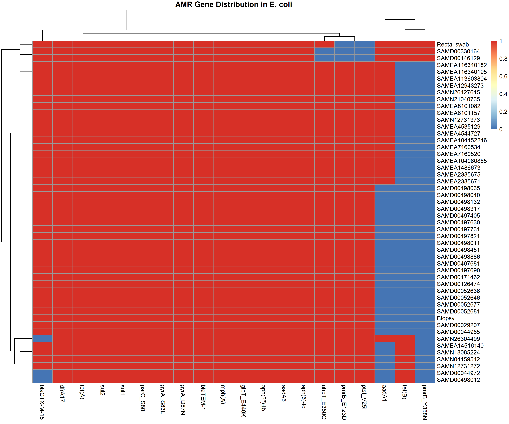
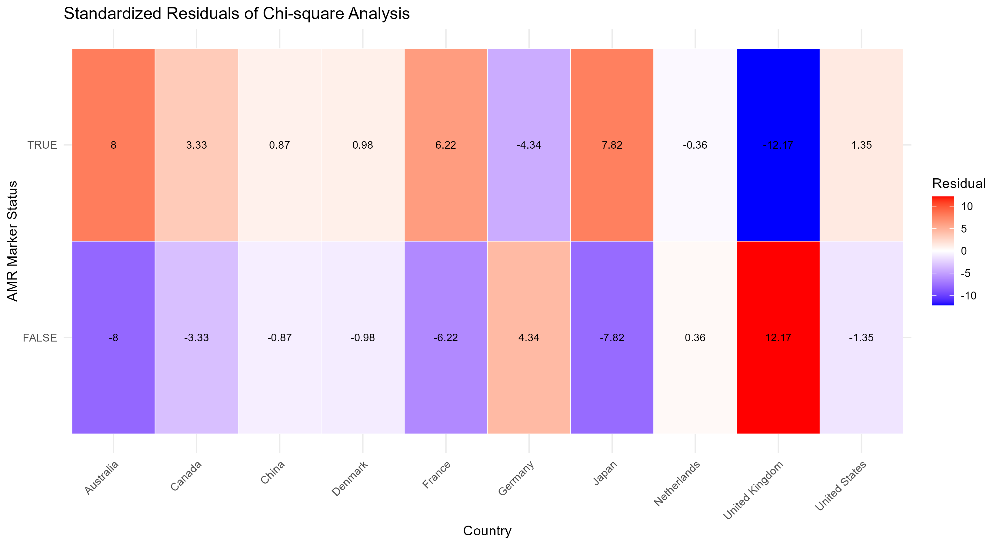

```{r setup, include=FALSE}
knitr::opts_chunk$set(echo=FALSE, warning=FALSE, message=FALSE,
                      fig.align="center", out.width="95%")
library(readr)
library(dplyr)
library(knitr)
library(kableExtra)
```

# Executive Summary

This report analyses the saved outputs of the AMRnet *Escherichia coli* project. It uses the original R scripts, saved CSV/TXT result tables and original project plots. The outputs support a database-level descriptive analysis. They do not demonstrate execution of the separate NCBI genome-download/AMRFinderPlus workflow or laboratory antimicrobial susceptibility testing.

# Project Scope

`AMRnet_Ecoli_Analysis.R` imports the compressed AMRnet dataset, standardises column names, calculates missingness, removes exact duplicate rows and generates descriptive summaries and plots. `AMR_Bioinformatics_ICA3.R` describes a separate genome workflow requiring real NCBI accessions, NCBI Datasets CLI and AMRFinderPlus. Matching execution outputs for that workflow are not present in this archive.

# Data and Methods

```{r data-load}
tab_dir <- "results/tables"
plot_dir <- "results/plots"
cat_tbl <- read_csv(file.path(tab_dir, "category_frequency.csv"), show_col_types=FALSE)
gene_tbl <- read_csv(file.path(tab_dir, "gene_frequency.csv"), show_col_types=FALSE)
country_tbl <- read_csv(file.path(tab_dir, "country_amr_analysis.csv"), show_col_types=FALSE)
missing_tbl <- read_csv(file.path(tab_dir, "missing_values_summary.csv"), show_col_types=FALSE)
resid_tbl <- read_csv(file.path(tab_dir, "chi_square_residual_analysis.csv"), show_col_types=FALSE)
```

The missingness percentages imply approximately 312.8 thousand rows, based on rounded count/percentage pairs. Category percentages imply an eligible denominator around 259.5 thousand. These should not be treated as the same denominator. The country table contains 137 labels and 223,675 records with country metadata.

# Data Quality and Missingness

```{r missing}
missing_tbl |> arrange(desc(missing_percent)) |> slice_head(n=20) |>
  kable(caption="Twenty variables with the highest missingness") |> kable_styling()
```

# AMR Category Results

```{r category}
cat_tbl |> kable(caption="Saved AMR category frequency output") |> kable_styling()
```


# Resistance-Associated Determinants

The gene-frequency output contains 794 determinant labels. The leading determinant is `glpT_E448K` (223,637), followed by `pmrB_Y358N` (116,283).

```{r genes}
gene_tbl |> slice_head(n=30) |>
  kable(caption="Top 30 reported determinants") |> kable_styling()
```




# Geographical Analysis

```{r countries}
country_tbl |> arrange(desc(Total_Samples)) |> slice_head(n=20) |>
  kable(caption="Top 20 countries by number of records") |> kable_styling()
```


# Statistical Analysis

The saved Pearson chi-square result is X-squared = 305.7, df = 9, p < 2.2e-16. Adjusted Cramer's V is 0.04, with a reported 95% interval [0.04, 1.00]. The point estimate indicates a very weak association; the interval should be validated. The full contingency table and expected counts were not included in the saved outputs.

```{r residuals}
resid_tbl |> arrange(adjusted_p) |>
  kable(caption="Saved chi-square residual analysis") |> kable_styling()
```



# Discussion and Limitations

Country percentages describe records in this AMRnet extract, not national population prevalence. Uneven sample sizes, surveillance coverage and database submission practices affect comparisons. Genotypic markers are not equivalent to laboratory-confirmed phenotypic resistance. Exact duplicate-row removal does not prove that all records are independent isolates. The Cramer's V confidence interval and chi-square assumptions require verification.

# Conclusion

The supplied project provides a useful exploratory analysis of AMRnet *E. coli* records. Fosfomycin-associated markers are the most frequent category and `glpT_E448K` is the most frequent determinant in the saved output. The chi-square test is significant, but the effect-size point estimate is very small. Interpret results as patterns in submitted database records, not national prevalence or confirmed AST outcomes.

# Reproducibility

The original scripts, compressed dataset snapshot, all saved output tables and selected original plots are included in the cleaned project package. Open this R Markdown file in RStudio from the package root and render to HTML or PDF. This report uses saved outputs rather than re-running the complete analysis.
